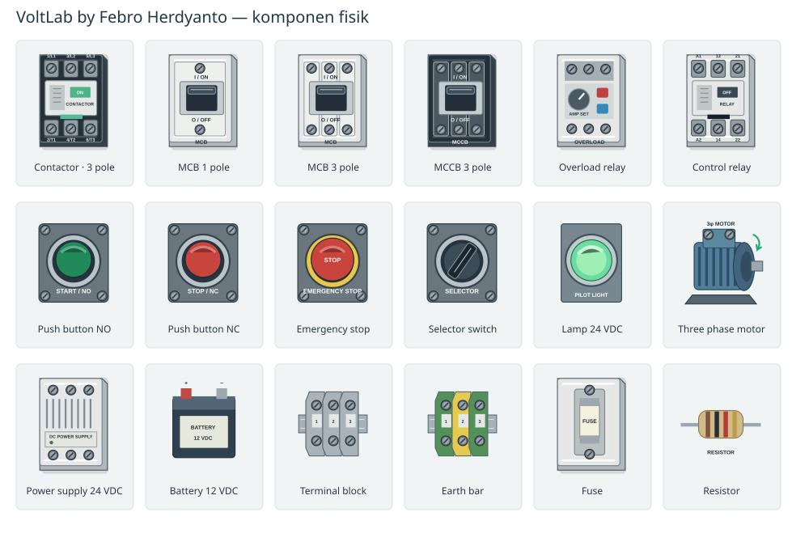

# VoltLab by Febro Herdyanto

Versi self-hosted untuk VPS: Next.js/React/TypeScript, PostgreSQL, Google OpenID Connect dan akun administrator lokal. Paket ini menggantikan ketergantungan ChatGPT sign-in/D1 pada versi hosted awal. Aplikasi sebelumnya tidak otomatis berubah; deploy paket ini ke domain VPS Anda.

Deployment utama memakai **PM2 + Nginx + PostgreSQL native**, tanpa Docker. `ecosystem.config.json` menjalankan aplikasi di loopback port 3025 (APP_PORT).

Baca **PANDUAN-VPS.md** untuk pemasangan, Google OAuth, akun admin, backup dan update.

## Tampilan panel dan komponen (2.4.1)

Canvas memiliki tiga tampilan: **Panel** menampilkan kabinet, nameplate, duct, komponen dan DIN rail yang ditambahkan dari katalog secara terpisah; perangkat ditempatkan dengan jarak yang cukup; **Fisik** menampilkan perangkat tanpa rail; **Skematik** menampilkan simbol rangkaian. Di mode Panel dan Fisik, titik terminal yang digambar dan ujung kabel disejajarkan dengan kepala baut pada komponen yang terminalnya tampak. Posisi ikut berputar bersama komponen, sementara bend dan label kabel diberi sela agar tidak menumpuk pada satu garis. Ilustrasi generik, bukan foto produk atau terminal spesifik suatu merek.

Lihat **UPDATE-CANVAS.md** untuk pembaruan canvas melalui PM2. Admin login dapat dibuka langsung di `/login?admin=1`; halaman login utama hanya menampilkan Google.

## Fitur 2.4.1

- Titik sambungan kabel pada panel/fisik menempel ke baut terminal komponen; bend dan label kabel lebih terpisah.

## Fitur 2.4.0

- Setelah login, halaman awal adalah dashboard dengan progres, pelajaran berikutnya, rangkaian terakhir dan quick create.
- Landing page publik disusun ulang, tersedia dalam dua bahasa dan tema terang/gelap. Halaman `/privacy` dan `/terms` dapat dibuka tanpa login dan ditautkan dari landing serta login; gunakan URL `https://voltlab.febro.id`, `https://voltlab.febro.id/privacy`, dan `https://voltlab.febro.id/terms` di Google Auth Platform.
- Materi bertahap dalam 8 modul dari Beginner sampai Expert tersedia dalam Bahasa Indonesia dan English; istilah teknis perangkat tetap dipakai. Dua PDF panduan dapat diunduh dan mencantumkan kredit VoltLab by Febro Herdyanto.
- DIN rail merupakan komponen Mounting mandiri agar tidak bertumpuk otomatis dengan perangkat. Katalog menambah relay, protective devices, drive, PLC, sensor, safety dan pengukuran. Komponen tanpa model dinamis ditandai reference only.
- Sidebar ponsel dapat ditutup lewat tombol X, scrim, navigasi atau tombol Escape.

## Fitur utama

- Panel generator 1–8 feeder motor DOL dengan sumber 400 VAC bersama, pemutus utama, kontrol 24 VDC, START/STOP/holding/overload tiap feeder dan opsi common emergency stop.
- Group komponen, perpindahan group, duplikasi sub-rangkaian, align/grid/distribute, reusable circuit blocks tersimpan per user, navigator/focus group atau tag.
- Label dan nomor kabel, pengaturan routing bend X, CSV BOM dan daftar kabel.
- Batas rangkaian 300 komponen / 2.000 kabel; performance diverifikasi untuk contoh 8 feeder dan fixture 100+ komponen, bukan benchmark semua topologi maksimum.
- Google login; database sesi server-side; setiap workspace diisolasi berdasarkan ID session.
- Admin: daftar/search/pagination user, statistik, tambah akun user, blokir/aktifkan, revoke session, hapus dengan konfirmasi email dan audit log. Isi rangkaian user tidak dibuka melalui panel admin.
- Admin allowlist tetap: `febroherdyanto98@gmail.com` → `febroherdyanto`, `febroherdyanto@outlook.com` → `fbrhrdynt`. Role tidak diambil dari field frontend maupun nama tampilan Google.
- Login password hanya untuk dua identitas admin, dibuat manual di terminal dengan scrypt; tidak ada password bawaan.
- Donasi: https://saweria.co/fbrhrdynt pada sidebar/login/admin. Tidak ada proses pembayaran atau penyimpanan detail transaksi di VoltLab.

## Arsitektur

`components/VoltLab.tsx` UI simulator. `PanelTools.tsx` alat panel dan `AdminUsers.tsx` UI administratif. `lib/voltlab` menyimpan model Zod, engine graph/nodal, calculator, materi dan generator panel. Simulasi berlangsung lokal di browser dan tidak membutuhkan request server untuk operasi tombol/coil.

`server/auth.ts` mengelola session, origin checks, input size dan rate limiting. `server/policy.mjs` merupakan allowlist admin. Login Google memvalidasi JWT dengan JWKS Google memakai jose: signature RS256, issuer, audience, expiry, nonce, verified email; flow memakai state dan PKCE. ID Google (`sub`) diikat ke account dan tidak diganti otomatis. Password admin memakai scrypt salt acak. Cookie session HttpOnly/Secure/SameSite Lax, session token disimpan hanya hash di PostgreSQL. Blokir user mencabut session aktif.

`server/db.ts` menyediakan pool PostgreSQL. `migrations/001_initial.sql` membuat users, sessions, workspaces, audit events, rate limits. Workspace menyimpan JSONB circuit dan progress; tabel akun/session/audit dinormalisasi. Setiap query workspace memakai ID dari session. `If-Match` revision mencegah tab berbeda menimpa perubahan tanpa peringatan. Draft darurat browser diberi key per user dan dihapus saat logout/sukses save.

## Pengembangan lokal

Node 22 LTS dan PostgreSQL 17 direkomendasikan. `npm ci`, salin `.env.example` ke `.env`, atur `DATABASE_URL` ke database development dan `APP_URL=http://localhost:3025`, jalankan `npm run db:migrate`, `npm run admin:setup`, `npm run dev`. Development cookie tidak memakai Secure. Jangan gunakan database produksi untuk pengembangan. Production wajib `APP_URL=https://...`.

- `npm run check`: TypeScript.
- `npm test`: 21 pengujian engine/panel dan 7 pengujian policy/crypto.
- `npm run test:api`: API handler asli dan middleware auth pada PostgreSQL embedded PGlite; adapter transport PostgreSQL dan cookie context Next diganti khusus di harness. Menguji migrasi, isolasi, revision conflict, CSRF, user biasa menolak akses admin, block/revoke, delete cascade dan audit.
- `npm run build`: production Next.js build.
- `npm run db:setup`: bootstrap role/database PostgreSQL baru dengan sudo psql.
- `npm run db:backup`: backup PostgreSQL native.

Untuk menambah komponen: tambahkan definisi katalog dan perilaku engine lalu fixture. Jangan menandai component sebagai simulation ready sebelum model diuji. Untuk validation rule: issue terstruktur berada di engine, bukan UI/LLM. Untuk materi belajar: `learning.ts`.

## Perilaku simulasi dan batasan

Wire dan kontak konduktif membentuk net; resistor/beban linear memakai nodal solve. AC ideal memakai phasor RMS 120°. Coil/kontak dievaluasi sampai stabil. Holding memerlukan state sebelumnya. Trip breaker pada short dibatasi pada jalur konflik yang terdeteksi, bukan semua feeder; selektivitas/kurva proteksi fisik tidak dimodelkan. Overload masih manual trip, motor berupa logika suplai tiga fase, bukan simulasi elektromagnetik.

Timer, star-delta otomatis, diode nonlinear/rectifier, transien kapasitor, kurva thermal, tabel ampacity dan verifikasi instalasi nyata belum tersedia. Model Reference-only tetap diberi label. Panel kompleks yang didukung berfokus pada rangkaian DC/AC kontrol dan kumpulan feeder DOL. Resistance probe awal hanya menguji jalur konduktif ideal. Hasil kalkulasi sizing adalah estimasi edukasi.

## Verifikasi dan deployment

Build Next.js, engine tests, policy tests dan PostgreSQL integration harness telah dijalankan. Login Google live memerlukan Client ID/Secret milik operator, domain HTTPS, dan redirect URI terdaftar; belum bisa diuji end-to-end tanpa kredensial itu. Konfigurasi PM2 dan startup native disediakan; pemasangan PostgreSQL/PM2 pada VPS perlu dilakukan mengikuti panduan. Tidak ada klaim aplikasi sudah terpasang di VPS Anda.

## Sumber teknis

- https://developers.google.com/identity/openid-connect/openid-connect
- https://nextjs.org/docs/app/guides/self-hosting
- https://pm2.io/docs/runtime/guide/startup-hook/
- https://pglite.dev/docs/api
